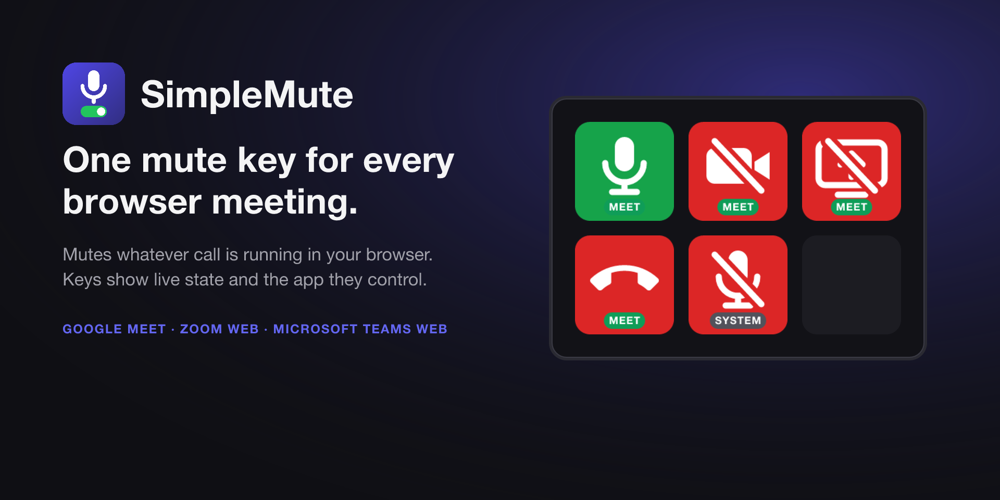

<p align="center">
  
</p>

# SimpleMute

One mute key for every browser meeting. SimpleMute lets a Stream Deck key mute your microphone, toggle your camera, stop a screen share or leave the call in whatever meeting is running in your browser. The keys show live state and a small label naming the app they control.

Works with **Google Meet**, the **Zoom web client** and **Microsoft Teams web**, in Chrome, Edge, Brave and Arc, across any number of browser profiles. Everything runs on your computer: no account, no cloud, no data collection.

SimpleMute is two parts that talk to each other over localhost:

- a **Stream Deck plugin**, which runs inside the Stream Deck app, and
- a **browser extension**, which finds the meeting tab and clicks its buttons.

## Install

**Requirements:** Stream Deck app 7.1 or newer on macOS 12+ or Windows 10+, and Chrome 116 or newer (or Edge, Brave, Arc).

### 1. Stream Deck plugin

Download `co.anam.simplemute.streamDeckPlugin` from the [latest release](https://github.com/theanam/streamdeck-simplemute/releases) and double-click it. The Stream Deck app installs it and a **SimpleMute** category appears in the action list.

### 2. Browser extension

Install it from the Chrome Web Store (link coming soon), or load it unpacked:

1. Download or clone this repository.
2. Open `chrome://extensions`, turn on **Developer mode**, click **Load unpacked** and pick the `extension/` folder.
3. Repeat in every browser profile you use for meetings.

The extension's toolbar icon shows a red `!` until it reaches the plugin, which normally takes a second or two with the Stream Deck app running.

### 3. Add a key

Drag **Mute** from the SimpleMute category onto a key. Join a meeting and the key turns green or red within a second.

## Keys

| Key | What it does |
| --- | --- |
| **Mute** | Toggles the microphone of the meeting running in your browser. With no meeting open, it mutes or unmutes the operating system's default input instead (macOS only). |
| **Camera** | Toggles the meeting's camera. |
| **Share Screen** | Stops an active screen share. When not sharing, it clicks the site's share control. |
| **Leave Meeting** | Leaves the meeting with a single press. |

### What the colors mean

| Key looks like | Meaning |
| --- | --- |
| Green with a MEET, ZOOM or TEAMS label | Device is live in that meeting. Press to mute or turn off. |
| Red, slashed, with a label | Device is muted or off. Press to unmute or turn on. |
| Red handset with a label | Leave key while in a meeting. |
| Green or red with a SYSTEM label | No meeting open; the Mute key shows the state of your Mac's microphone. An orange dot means the extension is not connected. |
| Grey, slashed | Extension connected but no meeting open. Pressing shows an alert. |
| Dark grey with an orange dot | No extension connected: the browser is closed, the extension is disabled, or the plugin's port is taken. |

A custom image set on the key in the Stream Deck app overrides these; remove it to get live state back.

### Several meetings or profiles

A key press always acts on exactly one meeting: the one you focused or joined most recently. That holds across tabs and across browser profiles, each of which keeps its own connection to the plugin.

## How it works

```
Stream Deck key
   │ key press
   ▼
Stream Deck app ──launches──▶ SimpleMute plugin (Node.js, @elgato/streamdeck)
                                │  WebSocket server on ws://127.0.0.1:51234
                                │
              command ▼         ▲ state / result
                                │
                    Browser extension service worker
                                │
                      message ▼         ▲ state
                                │
            Content script in the Meet / Zoom / Teams tab
                (site adapter reads and clicks the buttons)
```

The content script polls the meeting's mute, camera and share buttons a few times a second and reports changes. The plugin draws the key from that state and sends a command when you press it. Nothing touches your audio or video streams; the extension only clicks the buttons the site already shows, so the meeting always displays the truth.

The plugin accepts connections only from a browser extension origin, so web pages cannot reach it.

## Privacy

SimpleMute collects nothing. The only network traffic is between the plugin and the extension on `127.0.0.1`. See [PRIVACY.md](PRIVACY.md) for the full policy and the reason behind each browser permission.

## Limitations

- **Starting a screen share** depends on the site. Browsers only open the screen picker from a click inside the page, so the key clicks the share control and the site decides what happens. Stopping a share always works.
- **System microphone fallback** is macOS only. It uses the system input volume (mute sets it to 0 and unmute restores the previous level), which affects every app. Windows shows the idle icon when no meeting is running.
- **Zoom** button labels are matched in English only. Meet works in any language. Teams support is experimental.
- Native desktop apps (Zoom desktop, Teams desktop) are not supported.
- No raise hand, no Stream Deck+ dials, no settings panel.

## Troubleshooting

**Key stays dark grey.** The extension cannot reach the plugin. Check that the Stream Deck app is running and the plugin is installed. If another program is using port 51234, the plugin logs the conflict and retries every 3 seconds; see the plugin's `logs/` folder inside the plugin directory.

**Key stays grey in a meeting.** The extension did not find the meeting's buttons. Open the meeting tab's DevTools console, select the extension's context in the dropdown, and look for `[SimpleMute] state` lines. `inMeeting: false` during a live call means a selector needs updating; see [Fixing a selector](#fixing-a-selector).

**Pressing a key shows an alert.** No meeting is open, the button was not found, or the content script did not answer within 2 seconds. Reload the meeting tab.

**After updating the extension.** Reload it on `chrome://extensions`. Open meeting tabs get the new script automatically.

## Development

```sh
git clone https://github.com/theanam/streamdeck-simplemute.git
cd streamdeck-simplemute
npm install                  # test harness for the extension
cd plugin && npm install && npm run build
npx streamdeck link co.anam.simplemute.sdPlugin
npx streamdeck dev           # enables the Stream Deck app's developer mode, needed for restart/stop
```

Useful scripts:

| Where | Script | What it does |
| --- | --- | --- |
| `plugin/` | `npm run build` | bundle to `bin/plugin.js` |
| `plugin/` | `npm run watch` | rebuild and restart the plugin on every change |
| `plugin/` | `npm run typecheck`, `npm run validate` | TypeScript and manifest checks |
| `plugin/` | `npm run icons` | regenerate every key image and icon from SVG |
| root | `npm test` | syntax check, extension tests (jsdom), worker integration test, bridge tests |
| root | `npm run pack` | build the `.streamDeckPlugin` and the extension zip under `store/` |
| root | `npm run assets:store` | regenerate store listing images |

Tests bind to random ports, so they run with the Stream Deck app and the extension active.

### Repository layout

```
plugin/                       Stream Deck plugin (TypeScript, @elgato/streamdeck 3)
  src/plugin.ts               entry point
  src/config.ts               port, origin allowlist, timeouts, plugin UUID
  src/bridge.ts               WebSocket server and client tracking (no SDK imports, unit-tested)
  src/system-mic.ts           macOS default-input mute
  src/actions/media-toggle.ts Mute, Camera, Share Screen, Leave Meeting keys
  scripts/make-icons.mjs      renders all PNGs from SVG
  co.anam.simplemute.sdPlugin/   manifest, built bin/plugin.js, generated imgs/
extension/                    Browser extension (Manifest V3, plain JavaScript, no build step)
  background.js               service worker: connection, meeting registry, focus tracking, command relay
  content/common.js           shared content-script runtime
  content/meet.js, zoom.js, teams.js   one adapter per site
  test/                       jsdom adapter tests and the worker integration test
store/                        listing copy, images and packaged builds for both stores
scripts/                      packaging and asset generation
```

### Protocol

JSON text frames over `ws://127.0.0.1:51234`. The extension is the client. Unknown message types are ignored on both sides.

| Direction | Type | Fields |
| --- | --- | --- |
| ext → plugin | `hello` | `version`, `clientId` (random UUID per browser profile) |
| ext → plugin | `state` | `inMeeting`, `site`, `mic`, `camera`, `share` (`"on"`, `"off"`, `"unknown"`), `focused` |
| ext → plugin | `ping` | keep-alive every 20 s |
| plugin → ext | `command` | `id`, `action` (`"toggle"` or `"leave"`), `kind` (`"mic"`, `"camera"`, `"share"`, `"leave"`) |
| ext → plugin | `result` | `id`, `ok`, optional `error` |

Before opening the WebSocket, the extension probes the port with a plain HTTP request, which the plugin answers with `426 Upgrade Required`. This keeps the browser's error console clean while the Stream Deck app is closed.

### Fixing a selector

Meeting sites change their markup from time to time. Each site is one file under `extension/content/`, and nothing else needs to change for a selector fix.

1. In the meeting tab, use DevTools' element picker on the mic button and note a stable attribute. Meet uses `data-is-muted` plus an `aria-label` ending in the keyboard shortcut; Zoom uses class names such as `join-audio-container__btn`; Teams uses element ids and `data-state`.
2. Edit `meet.js`, `zoom.js` or `teams.js`. Each adapter exposes `mic()`, `camera()` and `share()` returning `{ button, on }` or `null`, and `leave()` returning `{ button, confirm? }` or `null`. Use `util.visible()` to skip hidden duplicates and `util.label()` to read the accessible label.
3. Add a fixture to `extension/test/<site>.test.js`, run `npm test`, reload the extension.

Pull requests with selector fixes or new site adapters are welcome.

### Customizing

- **Port:** `BRIDGE_PORT` in `plugin/src/config.ts` and `PORT` in `extension/background.js`. Change both.
- **Plugin UUID:** `co.anam.simplemute` appears in `plugin/src/config.ts`, the plugin manifest, the plugin folder name, `plugin/package.json`, `plugin/rollup.config.mjs` and `plugin/scripts/make-icons.mjs`.
- **Lock the bridge to one extension ID:** pin the extension ID with a `key` in `extension/manifest.json`, then replace the pattern in `isAllowedOrigin()` in `plugin/src/config.ts` with an exact match.

## Distribution

`npm run pack` builds `store/elgato/co.anam.simplemute.streamDeckPlugin` (installs by double-click, or upload to the Elgato Marketplace through Maker Console) and `store/chrome/simplemute-extension.zip` (upload to the Chrome Web Store). Listing copy, image assets and the upload checklist for both stores are in [store/LISTING.md](store/LISTING.md).
